# CourseStudio R0 — 重置前工程审计报告

- **审计日期**：2026-10-26
- **文档性质**：只读工程审计报告；不构成架构实现、迁移授权或删除授权。
- **审计方式**：只读 Git / 文件 / 依赖 / 调用链分析；未修改任何源码、配置、已有文档、Skill、测试或课程产物。本文件是本次审计新增的报告。
- **工作区状态**：审计执行期间为 `## main...origin/main`，无未提交变更；本地 HEAD 与远端 `main` 均为 `e4e744e`。写入本报告后，工作区仅新增本文件（untracked），未修改任何已有文件。
- **验证等级**：`VERIFIED`（本次实际执行并取得证据）、`STATIC`（源码/配置静态确认）、`PARTIAL`（证据不完整）、`NOT_RUN`（未执行）、`UNKNOWN`（现有信息无法判断）。

> 本次审计重点读了框架文档、全部自有 Python/PowerShell 工具、CI、Skill 契约，以及真实课程样本 `transformer-self-attention`。`tools/paper-search-mcp` 是 138 个文件、约 102MB 的 vendored 上游仓库，本次只审查其集成点、启动器、Skill 与来源记录，未逐行审查其全部实现。

---

## 1. 现状摘要

### 1.1 项目实际状态

CourseStudio 目前是一个**以 Markdown 规范 + Claude Code 会话为编排器、以 PowerShell/Python 脚本为执行工具**的课程生产工作区，而不是一个可独立运行的程序化流水线。

实际主路径为：

```text
new-episode.ps1 建集
  → 人工/LLM 研究（00–06，paper-search 辅助）
  → LLM 写讲稿（[SLIDE] / [ANIMATION] / [SEGMENT]）
  → LLM 写 Motion Canvas scene/project
  → build-recording-package.py 生成 05_recording/
  → LLM 写 Reveal 课件（course）或 Slidev 课件（technical/news）
  → check-episode.py 分阶段检查
  → 人工 OBS 录制 + 后期
```

真正的“状态机”只存在于 [workflows/claude-orchestrator.md](workflows/claude-orchestrator.md) 的自然语言规则里；程序只提供单点检查器，不保存阶段状态、不计算输入输出哈希、不自动恢复。

### 1.2 主要技术栈

| 层 | 实际使用 |
| --- | --- |
| 编排 | Claude Code + Markdown 契约 + `handoff.md` |
| 校验 | Python 3.12：`check-episode.py`、`script_timing.py`、`build-recording-package.py`、`check-links.py`、回归测试 |
| 动画 | Motion Canvas 3.17.2 + Vite 5.4.21 + Node 24 + pnpm 10 |
| 课件 | Reveal.js 6.0.2（course 默认）；Slidev 53.0.0（technical/news/旧课） |
| 兜底动画 | ManimCE 0.22.0（文档声明；当前机器实际未安装） |
| 检索 | vendored `paper-search` CLI（项目内 `.venv`，不是 MCP） |
| 录制 | 人工 OBS（二进制存在，但未执行任何录制） |

本次实际验证的运行时版本与文档一致：Reveal `6.0.2`、Slidev `53.0.0`、Motion `3.17.2`、Vite `5.4.21`、Node `v24.14.1`、pnpm `10.34.1`、ffmpeg `8.1`、Python `3.12.10`。

### 1.3 最关键的三个问题

1. **Gate 会说“通过”，但它没有验证运行时。**
   `check-episode.py --stage qa --strict` 对真实课程返回 `Status: PASS_VERIFIED`，同一份输出里却写着 `Build: SKIPPED`、`real=NOT_VERIFIED`。这直接违反项目自己的状态定义：`PASS_VERIFIED` 应为“实际运行并核对”。

2. **主路径的核心能力不在仓库里，且默认动画 Skill 没有注册。**
   生产讲稿用的 `course-studio`、研究输入用的 `research-to-course-synthesis` 只存在于 `<home>\.claude\skills`；仓库内只有 `motion-isolation` / `manim-isolation`。更严重的是：默认的 `motion-isolation` **没有** 注册为全局 Skill，而 legacy 的 `manim-isolation` **已经** 注册。一次干净重置或换机器，主路径无法按文档复现。

3. **文档规定的阶段顺序无法按字面执行，研究台账也不符合自己声明的 schema。**
   `--stage motion` 硬性要求 `05_recording/cues/<name>.md` 已存在，但该文件由更晚的 `build-recording-package.py` 生成；新集按文档顺序会在 M2 卡住。真实课程的台账只有 8 列，而 `01_research/README.md` 和研究 Skill 都声明 15 列 Core 14 schema。

---

## 2. 模块清单

| 模块 | 文件路径 | 实际职责 | 上游输入 | 下游输出 | 验证状态 | 主要问题 | 建议处理 |
| --- | --- | --- | --- | --- | --- | --- | --- |
| 项目指令 | [CLAUDE.md](CLAUDE.md) | Agent 出厂规则、停点、硬约束 | 无 | Agent 行为 | STATIC | 与 README/requirements 大量重复 | 保留，改为指向单一契约 |
| 根说明 | [README.md](README.md) | 项目定位、状态表、工具分工 | 无 | 使用者认知 | STATIC | 状态表把历史运行写成当前能力；OBS/Manim 描述已漂移 | 重构，状态由程序生成 |
| 编排状态机 | [workflows/claude-orchestrator.md](workflows/claude-orchestrator.md) | R/S/M/RC/P/Q 子步骤、停点、`/clear` | `handoff.md` | 下一子步骤 | STATIC | 不是可执行 FSM；依赖模型遵守 | 保留规则，增加 `episode.json` |
| 执行契约 | [workflows/episode-pipeline.md](workflows/episode-pipeline.md) | 目录契约、Stage 0–8、Gate | 无 | 全流程 | STATIC | 与 README/requirements/quickstart 重复 | 合并为唯一契约 |
| 旧课程流程 | [workflows/course.md](workflows/course.md) | 通用课程原则 + legacy HTML/Manim 路径 | 无 | 旧项目维护 | STATIC | 仍称“每课独立仓库是默认”，与实际相反 | 归档为 legacy 附录 |
| 模式文档 | [workflows/technical-explainer.md](workflows/technical-explainer.md)、[news-analysis.md](workflows/news-analysis.md) | 领域证据规则 | 无 | 模式化写作 | STATIC | 与 episode-pipeline 重复 | 保留为模式附录 |
| 审计记录 | [workflows/pipeline-audit.md](workflows/pipeline-audit.md) | 历史修复与状态声明 | 无 | 历史参考 | PARTIAL | 32/32、Slidev build、Manim 等历史结论无持久日志 | 保留为历史，不与当前状态混用 |
| 指南 | [guides/](guides/) | 快速开始、教程、质量、受众、编辑、仓库 | 无 | 操作规范 | STATIC | 状态定义与流程规则重复 20+ 处 | 合并/生成 |
| 任务入口 | [prompts/](prompts/) | 可粘贴的课程/新闻/修订提示词 | 用户材料 | Agent 任务 | STATIC | 与主路径规则可能漂移 | 保留，引用唯一契约 |
| 建集脚本 | [tools/new-episode.ps1](tools/new-episode.ps1) | 复制模板、`uv init`、可选 Manim、删除未用课件 | 模板 | 新课程目录 | STATIC | 不 `git init`；不写 `uv.lock`（无依赖时）；无状态文件 | 重构 |
| 建集模板 | [tools/episode-template/](tools/episode-template/) | Episode 目录/文件模板 | 无 | 新课程初始文件 | STATIC | `example` cue/manifest 可能被误当真实产物 | 保留 |
| Motion 模板 | [tools/motion-runtime/](tools/motion-runtime/) | Motion Canvas 工程模板 | 无 | `04_motion_src/` | VERIFIED（3.17.2 已安装） | 无 typecheck 门禁 | 保留 |
| Motion 运行器 | [tools/motion-run.ps1](tools/motion-run.ps1) | 安装依赖、启动 Vite、打印录制 URL | scene/project | `record.html?segment=` | STATIC | 首次运行隐式联网安装 | 保留 |
| Reveal 运行时 | [tools/reveal-runtime/](tools/reveal-runtime/) + [tools/reveal-run.ps1](tools/reveal-run.ps1) | 同步 `.vendor`、Python 静态服务 | runtime 依赖 | `03_slides/.vendor/`、HTTP 服务 | VERIFIED（6.0.2 已安装；服务未启动） | 无构建/浏览器检查；`.vendor` 不可提交 | 保留并加运行时检查 |
| Slidev 运行时 | [tools/slidev-runtime/](tools/slidev-runtime/) + [tools/slidev-run.ps1](tools/slidev-run.ps1) | dev/build technical/news | slides.md | `dist/` 或 dev server | VERIFIED（53.0.0 已安装；build 未跑） | 仅在 strict QA 的 Slidev 路径隐式 build | 保留 |
| Manim 兜底 | [tools/render-manim.ps1](tools/render-manim.ps1) | 课程 `.venv` 渲染单场景、复制 MP4 | scene.py | `03_slides/public/<name>.mp4` | NOT_RUN | 当前机器无 Manim；文档仍称 PASS_VERIFIED | 降级为可选 adapter |
| 默认动画 Skill | [tools/skills/motion-isolation/SKILL.md](tools/skills/motion-isolation/SKILL.md) | 45–90s Motion 叙事段落契约 | 讲稿/segments/theme | scene/project | STATIC | **未注册为全局 Skill** | 注册并纳入仓库版本控制 |
| Legacy 动画 Skill | [tools/skills/manim-isolation/SKILL.md](tools/skills/manim-isolation/SKILL.md) | Manim 单场景契约 | 讲稿/知识结构 | scene/MP4 | STATIC | 已注册，主路径未注册，优先级反了 | 降级/明确不默认加载 |
| 节奏解析 | [tools/script_timing.py](tools/script_timing.py) | 解析/校验 `[SEGMENT]` 与节奏标注 | 讲稿 | issues/warnings | VERIFIED（经 checker 执行） | 规则只覆盖结构，不覆盖画面语义 | 保留为核心库 |
| 阶段检查器 | [tools/check-episode.py](tools/check-episode.py) | 研究/讲稿/Motion/录制包/课件/QA 检查 | Episode 文件 | stdout/exit code | VERIFIED（本次执行全部 stage） | 状态语义错误；cue 顺序冲突；无运行时验证 | 重构 |
| 录制包生成器 | [tools/build-recording-package.py](tools/build-recording-package.py) | 从讲稿+segments 生成 manifest/cues/checklist | 讲稿、segments、scene/project | `05_recording/` | VERIFIED（`--check` 通过） | 非原子写入；端口硬编码；cue 生成时机与 gate 冲突 | 重构 |
| 回归测试 | [tools/test_check_episode_negative.py](tools/test_check_episode_negative.py) | 32 项负向/幂等测试 | 临时 fixture | unittest 结果 | VERIFIED（CI 32/32；本地未跑） | 不覆盖真实课程、cue 顺序、泄漏扫描 | 扩展 |
| 链接检查 | [tools/check-links.py](tools/check-links.py) | Markdown 相对链接 | 全仓 `.md` | pass/fail | VERIFIED（168 条通过） | 本地 168 vs CI 145，范围不同 | 保留 |
| CI | [.github/workflows/python-app.yml](.github/workflows/python-app.yml) | py_compile + 链接 + 32 测试 | 仓库 | CI 结果 | VERIFIED（run `40319878317` 成功） | 不跑真实课程/不构建/不渲染 | 扩展 |
| 检索 CLI | [tools/paper-search-mcp/](tools/paper-search-mcp/) | 论文检索/下载/抽取 | query | JSON/PDF | VERIFIED（`--help` 可用；检索未跑） | 102MB vendored；多份 Skill；含 Sci-Hub adapter | 冻结，明确上游版本 |
| 全局课程 Skill | `<home>\.claude\skills\course-studio-skill` | 讲稿、教学、HTML/Manim 默认 | 研究包 | 讲稿/页面 | STATIC | 仓库外、未锁版本、默认与主路径冲突 | vendor 或声明 pinned 依赖 |
| 全局研究 Skill | `<home>\.claude\skills\research-to-course-synthesis` | 00–06、Core 14 台账、4-Gate | 材料 | 研究包 | STATIC | 仓库外；15 列 schema 未被真实课程遵守 | vendor 或声明 pinned 依赖 |
| 真实课程样本 | [courses/transformer-self-attention/](courses/transformer-self-attention/) | 第一集完整产物 | 研究/讲稿/动画 | 录制就绪包 | PARTIAL | 台账 schema、泄漏、证据落盘、运行时验证 | 作为迁移对照 |
| 研究样本 | [courses/attention-research-2026-10/](courses/attention-research-2026-10/) | 46 主张 / 91 定位的研究输入包 | 11 篇 PDF | 00–06 + QA | PARTIAL | 未被 Git 跟踪；重置会丢 | 先备份/纳入版本管理 |
| 退役课程 | [courses/_retired/](courses/_retired/) | 历史 HTML/Slidev/Manim 对照 | 无 | 参考 | STATIC | 49MB 未跟踪；无 `.git` | 冻结，不删 |
| 本地实验 | [labs/](labs/) | 本机速查、Manim 实验 | 无 | 本地参考 | STATIC | `course-studio-usage.md` 已过期，仍描述旧 stage | 归档或更新 |

---

## 3. 真实生产流程图

实线表示本次能从代码/文档确认的调用关系；虚线表示人工步骤或未验证/未实现的自动关系。

```mermaid
flowchart TD
  OWNER["项目负责人"] -->|"PowerShell"| NE["tools/new-episode.ps1"]
  NE -->|"复制"| TPL["tools/episode-template"]
  NE -->|"复制"| MRT["tools/motion-runtime"]
  NE -->|"uv init / 可选 uv add manim"| ENV["课程 .venv"]

  OWNER -->|"提示词"| AGENT["Claude Code 会话"]
  AGENT -->|"读"| ORCH["workflows/claude-orchestrator.md"]
  AGENT -->|"读/写"| HANDOFF["handoff.md"]
  AGENT -->|"LLM 写"| RES["01_research 00-06"]
  PS["paper-search CLI"] -->|"JSON / PDF"| RES
  AGENT -->|"LLM 写"| SCRIPT["02_scripts/lecture_script.md"]
  AGENT -->|"读 Skill"| MIS["tools/skills/motion-isolation"]
  MIS -->|"LLM 写"| SCENE["04_motion_src/src/scenes + projects"]
  SCRIPT --> BRP["tools/build-recording-package.py"]
  SCENE --> BRP
  BRP -->|"写"| REC["05_recording/manifest + cues + checklist"]

  AGENT -->|"LLM 写"| DECK["03_slides/index.html 或 slides.md"]
  RR["tools/reveal-run.ps1"] -->|"复制 .vendor + python http.server"| DECK
  SR["tools/slidev-run.ps1"] -->|"dev/build"| DECK

  SCENE --> MRUN["tools/motion-run.ps1"]
  MRUN -->|"pnpm install + Vite"| VITE["record.html?segment=name"]
  VITE -.->|"人工 OBS，NOT_RUN"| OBS["OBS 录制"]
  OBS -.->|"mp4，未发生"| REC

  CE["tools/check-episode.py"] -->|"读全部产物"| GATE{"阶段 Gate"}
  CE -.->|"仅 Slidev strict"| SR
  CE -->|"ffprobe，仅有录像时"| REC
  CL["tools/check-links.py"] --> GATE
  T["32 项回归测试"] --> GATE
  CI[".github/workflows"] --> CL
  CI --> T
  GATE -->|"status/exit code"| HANDOFF

  AGENT -.->|"引用，不在仓库"| GCS["全局 course-studio"]
  AGENT -.->|"引用，不在仓库"| RCS["全局 research-to-course-synthesis"]
```



**图里没有画出的关键事实**：

- “有限状态机”没有程序化实现；判断当前阶段靠读 `handoff.md`，而 checker 只检查它是否存在。
- `check-episode.py --stage qa --strict` 只有在 Slidev 路径才会隐式调用 `slidev-run.ps1 -Mode build`；Reveal 路径完全跳过运行时检查。
- Motion 的浏览器播放、真实时长、typecheck 都不在任何 Gate 内；`record.html?probe=1` 只是人工/历史探针。
- OBS 是纯人工步骤，代码里没有任何调用或校验。

---

## 4. 问题清单

### P0 — 阻断“可信基线”的问题

#### P0-01 Gate 把静态/结构检查输出为 `PASS_VERIFIED`

- **位置**：[tools/check-episode.py:830](tools/check-episode.py#L830)、[tools/check-episode.py:828](tools/check-episode.py#L828)；状态定义见 [README.md](README.md)。
- **当前行为与证据**：本次实际执行 `python tools/check-episode.py transformer-self-attention --mode course --stage qa --strict`，输出：
  - `Status: PASS_VERIFIED`
  - `Build: SKIPPED (Reveal deck: build check deferred to Phase 4)`
  - `scores_to_weights: ... declared=68.0s, real=NOT_VERIFIED`

  同一份结果中，运行时未验证、构建未执行、录像不存在，但总体状态仍是 `PASS_VERIFIED`。此外，warnings 不会导致非零退出码：`return 1 if issues else 0`，因此缺 `handoff.md` 这类 warning 也能“通过 gate”。
- **实际风险**：使用者、后续 Agent 或交接文档会把“文件结构通过”误读为“课程已验证”。在重置后，这种假绿灯会让残缺产物进入录制。
- **建议处理**：把单一状态拆成四个维度：`STRUCTURAL`、`RUNTIME`、`HUMAN`、`DELIVERY`；只有实际执行并有日志的维度才能写 `VERIFIED`。`--strict` 应把必需 warning 升级为 failure。
- **验证方法**：注入缺失录像/缺失浏览器探针/缺失 handoff 的 fixture，断言 Gate 不得返回 `VERIFIED`；对真实样本重跑，输出应显示 `STRUCTURAL_PASS / RUNTIME_NOT_RUN / HUMAN_PENDING`。

#### P0-02 主路径 Skill 与契约在仓库外，且默认 `motion-isolation` 未注册

- **位置**：`<home>\.claude\skills`；[guides/repository-and-remote.md:113](guides/repository-and-remote.md#L113)；[tools/skills/](tools/skills/)。
- **当前行为与证据**：
  - 全局存在 `course-studio-skill`、`research-to-course-synthesis`，但仓库内没有它们的副本或版本锁定。
  - `~/.claude/skills/manim-isolation` 是指向仓库的 junction；`~/.claude/skills/motion-isolation` **不存在**。
  - 本次会话可用 Skill 列表中，`manim-isolation` 可用，`motion-isolation` 不可用。
- **实际风险**：干净重置或换机器后，默认动画路径没有对应 Skill；讲稿和研究 Skill 可能漂移；仓库无法单独复现生产。
- **建议处理**：把核心 Skill 移入仓库（或建立 `skills.lock` + 安装脚本），注册 `motion-isolation`，将 `manim-isolation` 标记为 legacy/不默认加载；CI 校验 Skill 存在与哈希。
- **验证方法**：在空 `HOME`/新用户配置下按仓库文档安装，确认 `motion-isolation` 出现在可用 Skill 列表；哈希与仓库一致。

#### P0-03 `--stage motion` 与 cue 生成阶段顺序冲突

- **位置**：[tools/check-episode.py:382-389](tools/check-episode.py#L382)、[tools/check-episode.py:714](tools/check-episode.py#L714)；阶段表见 [workflows/claude-orchestrator.md](workflows/claude-orchestrator.md) 与 [workflows/episode-pipeline.md](workflows/episode-pipeline.md)。
- **当前行为与证据**：`check_motion_segment()` 把缺失 `05_recording/cues/<name>.md` 加入 `problems`；`motion_is_issue = stage in {"motion","recording"} or strict`，因此在 M2/M3 的 `--stage motion` 中它是 hard issue。而 cue 由更晚的 Stage 4 `build-recording-package.py` 生成；`new-episode.ps1` 只复制模板的 `example` cue，不会为新 segment 名生成 cue。
- **实际风险**：按文档顺序新建一集，第一次 `--stage motion` 必然失败；只能提前运行后续阶段的生成器，或手工造 cue。这使“最小生产闭环”不可按文档执行，也掩盖了真正的顺序依赖。
- **建议处理**：在 motion 阶段把 cue 缺失降为 warning；在 recording 阶段再硬校验。或者把 cue 生成前移到 `segments.json` 冻结时（M1/M2），并让 builder 成为 motion gate 的前置。
- **验证方法**：用临时目录建一个新 episode，写一个非 `example` 的 segment，先跑 `--stage motion`（应通过并警告），再跑 `--stage recording`（应失败直到 builder）；把该场景加入回归测试。

---

### P1 — 高优先级、影响可信度或可迁移性

#### P1-01 真实课程台账只有 8 列，不符合声明的 Core 14 / 15 列 schema

- **位置**：[courses/transformer-self-attention/01_research/02-claim-evidence-ledger.csv](courses/transformer-self-attention/01_research/02-claim-evidence-ledger.csv)、[01_research/README.md:9](courses/transformer-self-attention/01_research/README.md#L9)、[05-quality-report.md:26](courses/transformer-self-attention/01_research/05-quality-report.md#L26)；全局研究 Skill 的 Core 14 定义在 `research-to-course-synthesis/SKILL.md:150`。
- **当前行为与证据**：真实表头是 `claim_id, claim, type, source_id, locator, evidence_snippet, scope, notes`，共 8 列；README 写“15 列主张—证据台账”；质量报告又写“14 行、8 字段”。研究 Skill 要求 `claim_id, claim_text, claim_type, source_ids, source_locators, inspection_scope, scope_limit, derivation_or_data, evidence_status, reasoning_status, execution_status, validation_status, conflict_status, used_in_artifact, review_notes`。
- **实际风险**：缺 `evidence_status` / `validation_status` / `conflict_status` / `used_in_artifact`，无法机器判断一条主张是否已定位核验、是否进入产物、是否存在冲突；“FACT”只是一个类型标签，不是验证状态。`check-episode.py` 只检查文件非空，完全不会发现这种降级。
- **建议处理**：以 Core 14 为唯一 schema；为现有 14 条主张做迁移映射（保留原文，补状态字段）；`check-episode.py` 增加 CSV 表头/枚举/ID 唯一性/定位覆盖率校验。
- **验证方法**：对全库台账跑 schema 校验；故意删一列或把 `FACT` 写成 `CONTRADICTED`，必须失败；迁移后逐条对照源 PDF/HTML。

#### P1-02 研究/QA 自动检查只验证“存在且非空”，不验证内容契约

- **位置**：[tools/check-episode.py:151-164](tools/check-episode.py#L151)（`research_status`）；[tools/check-episode.py:615](tools/check-episode.py#L615)。
- **当前行为与证据**：`course/technical` 只检查 `00`–`06` 存在且非空；`news/podcast` 只检查两个文件非空且含 `FACT|CLAIM`。没有检查台账列、`CLM` 编号、定位格式、冲突字段、`05-quality-report` 的 Four-Gate、来源与台账的交叉引用。
- **实际风险**：一个只有标题和占位句的研究包也能通过 `--stage research`；质量报告里的“4-Gate”“91/91 定位”等结论无法由仓库工具复现。
- **建议处理**：把研究包校验从“非空”提升为“schema + 引用完整性 + 定位格式 + 状态枚举”；为 `04`/`06` 增加必需章节检查；把研究 Skill 的 QA 脚本纳入仓库。
- **验证方法**：用缺列、重复 ID、无定位、无 `FACT/CLAIM`、引用不存在的 source 等 fixture 跑检查器，均应失败。

#### P1-03 仓库拓扑文档与实现不一致

- **位置**：[guides/requirements.md:15](guides/requirements.md#L15)、[guides/requirements.md:198-199](guides/requirements.md#L198)、[workflows/course.md:22-25](workflows/course.md#L22)、[tools/new-episode.ps1:17](tools/new-episode.ps1#L17)、[courses/README.md:121](courses/README.md#L121)。
- **当前行为与证据**：文档说“每门课程在 `courses/<slug>` 内独立 `git init`”“根仓库只提交框架，`courses/*` 不进根仓库”；实际：
  - `find courses labs tools -name .git` 只找到根 `.git`，没有任何课程嵌套仓库。
  - 根仓库跟踪 `courses/transformer-self-attention/` 的 41 个文件。
  - `new-episode.ps1` 明确“Does NOT run git init”。
  - 根 `.gitignore` 有 `!/courses/transformer-self-attention/` 例外。
- **实际风险**：重置时无法判断课程历史应放根仓库、独立仓库还是 submodule；若按文档执行 `git init`，会产生未跟踪的嵌套仓库；若继续根仓库跟踪，则与“根仓库只跟踪框架”及 CI 的课程边界假设冲突。
- **建议处理**：由负责人明确选择一种拓扑并在脚手架/CI/文档中强制；当前最省迁移成本的是“根仓库 + 明确课程白名单”，并把文档改为该事实；或采用 submodule 并自动化。
- **验证方法**：在 `courses/<slug>` 内执行 `git rev-parse --show-toplevel`，结果必须与文档一致；CI 检查 gitlink/嵌套 `.git`；新建课程按文档执行不产生歧义。

#### P1-04 默认 `course` 路径没有任何运行时验证

- **位置**：[tools/check-episode.py:828](tools/check-episode.py#L828)；[README.md:153](README.md#L153)；[guides/known-limitations.md](guides/known-limitations.md)。
- **当前行为与证据**：Reveal 路径的 strict QA 输出 `Build: SKIPPED`，不启动静态服务器、不加载页面、不截图、不检查 16:9/控制条/字体；Motion 路径不运行 `tsc`、不启动 Vite、不读 `probe=1`。唯一被实际执行的“运行时”是 technical/news 的 Slidev build（本次未跑）。
- **实际风险**：Reveal 缺资源、脚本报错、页面空白、Motion 场景编译错误，都可以通过 Gate；而 `course` 是默认模式，等于默认路径的验证最弱。
- **建议处理**：新增 `qa.runtime` 阶段：Reveal 启动静态服务 + headless Chrome 逐页加载/截图；Motion `pnpm typecheck` + Vite + `probe=1` 读帧数；Slidev build/dev 加载；所有输出写入 `qa/runs/<id>/`。
- **验证方法**：故意删除一个本地资源/在 scene 中引入类型错误/把 `Reveal.initialize` 改坏，runtime gate 必须失败；恢复后通过。

#### P1-05 观众版泄漏门禁未实现，真实 deck 已泄漏内部录制 URL

- **位置**：[guides/audience-vs-internal.md:66](guides/audience-vs-internal.md#L66)（要求 `scripts/check_consistency.py`）；真实 deck [03_slides/index.html:172](courses/transformer-self-attention/03_slides/index.html#L172) 与 [:202](courses/transformer-self-attention/03_slides/index.html#L202)。
- **当前行为与证据**：仓库内没有 `scripts/check_consistency.py`，只有退役课程里有同名脚本；`check-episode.py` 不做泄漏扫描。真实 deck 的 08/09 页直接显示 `record.html?segment=scores_to_weights`、`68 秒`、`独立录屏，不嵌入 MP4`——这是制作元数据/内部路径，按指南不应出现在观众版。
- **实际风险**：录屏时观众会看到内部工具 URL 与制作说明；没有自动门禁，后续课程会重复。
- **建议处理**：把泄漏扫描纳入 `check-episode.py --stage qa`；扫描 HTML/口播中的 `CLM-`、`S0x`、`qa/`、`research/`、`record.html`、`NOT_RUN`、`PASS_VERIFIED` 等；把动画占位改为演讲者备注或录制专用页，不进入最终 deck。
- **验证方法**：对真实 deck 跑扫描必须报出两处 `record.html`；修复后扫描通过；对含 `CLM-001` 的 fixture 必须失败。

#### P1-06 Motion 场景没有 typecheck / 编译 / 实际时长门禁

- **位置**：[tools/motion-runtime/package.json](tools/motion-runtime/package.json) 有 `typecheck` 脚本；但仓库中没有任何 gate 调用它（本次 grep 未发现引用）；[tools/check-episode.py:382-428](tools/check-episode.py#L382) 只检查文件存在与声明时长。
- **当前行为与证据**：`check_motion_segment()` 读取 `segments.json` 的 `duration_seconds`，检查 45–90，并检查 scene/project/cue 非空；不执行 `tsc`、不启动 Vite、不读 `durationFrames`。场景里的 `if (Math.abs(now - 68) > 0.001) throw` 只有浏览器运行才触发。
- **实际风险**：TypeScript 错误、运行时异常、实际时长与声明不符，都能通过 `--stage motion`；68s 的声明只是数字。
- **建议处理**：在 `--stage motion` 或新的 `qa.runtime` 中执行 `pnpm typecheck` 与 `record.html?segment=<name>&probe=1`，记录 `durationFrames/fps/seconds`；失败即 Gate 失败。
- **验证方法**：在 scene 中制造类型错误/把某段 `waitFor` 改成 20s，Gate 必须失败；恢复后 probe 应输出 68.0s。

#### P1-07 `handoff.md` 是自由文本，状态不可机检，证据未落盘

- **位置**：[tools/check-episode.py](tools/check-episode.py) 只检查 `handoff.md` 是否存在；真实 handoff 的“已运行命令/最后检查”见 [handoff.md:16-17](courses/transformer-self-attention/handoff.md#L16)。
- **当前行为与证据**：handoff 声称跑了 headless Chrome seek 到 8s/35s/50s/64s/67s 并截图、Reveal 12 页截图、播放器探针 4080 帧；但 `qa/` 只有 README 和 pointer，没有截图或日志。`04_motion_src/output/still/` 只有两张 PNG，文件名为 `000217.png`、`000974.png`（约 3.6s、16.2s），与声称的 5 个时间点不一致。
- **实际风险**：交接状态可能过期或夸大；无法从仓库复现“已经看过”的结论；`/clear` 后只能相信文本。
- **建议处理**：引入 `episode.json` 保存阶段、输入/输出哈希、已运行命令、退出码、证据路径；`handoff.md` 由该文件生成摘要；所有 QA 证据写入 `qa/runs/<timestamp>/`。
- **验证方法**：删除/篡改 `episode.json`，checker 必须失败；从任意阶段重跑，输出哈希与记录一致；`handoff.md` 可完全重建。

#### P1-08 CI 不验证真实课程产物

- **位置**：[.github/workflows/python-app.yml:12-28](.github/workflows/python-app.yml#L12)；CI run `40319878317` 日志。
- **当前行为与证据**：CI 实际只做三件事：`py_compile` 四个脚本、`check-links`、32 项回归；日志显示 `checked 145 relative links`、`Ran 32 tests ... OK`。没有对 `courses/transformer-self-attention` 跑 `check-episode`，没有构建 Reveal/Slidev，没有 typecheck Motion。
- **实际风险**：真实课程的结构/资源/课件回归不会被 CI 捕获；32 项测试只测 checker 自身。
- **建议处理**：增加一个 fixture course job，跑 `research/script/motion/recording/slides/qa --strict`；再增加可选 runtime job（Reveal 静态服务 + headless Chrome、Motion typecheck + probe、Slidev build）。
- **验证方法**：提交一个故意缺资源/坏锚点的 fixture，CI 必须失败；恢复后通过。

#### P1-09 能力声明与实际环境漂移（Manim / OBS）

- **位置**：[README.md:202](README.md#L202)、[workflows/pipeline-audit.md:167](workflows/pipeline-audit.md#L167)、[README.md](README.md) 状态表。
- **当前行为与证据**：
  - 文档称 Manim 0.22.0 `PASS_VERIFIED（legacy）`；实际 `manim --version` 不存在，系统 Python `import manim` 失败，没有任何活跃课程 `.venv`。
  - 文档称 OBS “未安装/未检测到”；实际 `<OBS install path>` 存在（只是不在 PATH）。
  - Playwright 确实未安装，文档正确。
- **实际风险**：重置规划会基于错误的能力假设；可能把“需要安装/联网”的步骤当成现成能力，或把已安装的 OBS 误判为缺失。
- **建议处理**：增加 `tools/probe-capabilities.ps1`，输出 Python/Node/pnpm/uv/ffmpeg/Chrome/OBS/Manim/Playwright/Reveal/Slidev/Motion 的实际版本与路径；文档状态表由 probe 结果生成。Manim 明确标为“可选 adapter，未安装”。
- **验证方法**：运行 probe，结果与文档一致；在 CI/新机器上跑同一 probe，差异可见。

---

### P2 — 中低优先级、影响维护成本或一致性

#### P2-01 规则重复且已出现漂移

- **位置**：`45–90` 在 22 个文件中重复；`PASS_VERIFIED` 在 34 个文件中出现 211 次；stage 表在 6 个文件中重复。
- **证据**：本次 grep 统计。已发现的具体漂移包括：
  - [guides/quickstart-episode.md](guides/quickstart-episode.md) 的 Reveal 课件页也写“不要用 `?present`”（`?present` 是 Motion 的概念）。
  - [guides/requirements.md:198](guides/requirements.md#L198) 说“根仓库只提交框架，`courses/*` 不进根仓库”，与同文件第 15 行的例外和实际跟踪冲突。
  - [labs/course-studio-usage.md](labs/course-studio-usage.md) 的 stage 表仍是 `slides → slides.md`、`recording = 人工录制`，没有 Motion/录制包阶段。
- **风险**：每次改规则要改 20+ 处；模型读到过期文档会执行错误路径。
- **建议**：建立单一 `pipeline.yaml`/JSON 契约，文档由它生成或只保留短索引；删除/归档重复段落。
- **验证**：链接检查和“文档引用唯一契约”的 grep 检查；人工抽查 3 个入口。

#### P2-02 legacy 工具与 stale 指南仍在主路径旁边

- **位置**：[tools/new-course.ps1](tools/new-course.ps1)、[workflows/course.md](workflows/course.md)、[labs/course-studio-usage.md](labs/course-studio-usage.md)、[courses/transformer-self-attention/qa/recording-checklist.md](courses/transformer-self-attention/qa/recording-checklist.md)。
- **证据**：`new-course.ps1` 仍会 `uv add manim` 并创建 `animations/manim`；`workflows/course.md` 自称 legacy 但仍写“当前约定是 A”；labs 指南缺少 Motion/recording 阶段。
- **风险**：新 Agent/新用户可能走旧路径；Manim 被误当默认。
- **建议**：把 legacy 工具移入 `tools/legacy/` 或在帮助中强制 `--legacy`；labs 指南更新或归档；qa pointer 在迁移后删除。
- **验证**：主路径文档不再引用 legacy 工具；grep 不到“当前约定是 A”。

#### P2-03 manifest / `record_status` 校验缺口

- **位置**：[tools/check-episode.py:518-570](tools/check-episode.py#L518)；[tools/build-recording-package.py:234](tools/build-recording-package.py#L234)、[:346](tools/build-recording-package.py#L346)。
- **证据**：manifest 的 `manifest_names` 是 `set`，重复名字被静默吞掉；没有校验 manifest 顺序与 `segments.json` 的 `order` 一致；`record_status` 从不与实际 `recordings/` 文件对账。cue 缺失只是 warning。
- **风险**：manifest 可以有重复/错序/虚假 `RECORDED` 状态而通过检查。
- **建议**：校验 manifest 名称唯一、顺序与 segments 一致、cue 必须存在；用 `ffprobe` 结果回填并校验 `record_status`。
- **验证**：构造重复/错序/假状态 fixture，均失败。

#### P2-04 硬编码盘符路径与端口

- **位置**：[tools/paper-search-mcp/bin/paper-search](tools/paper-search-mcp/bin/paper-search)、[tools/paper-search-mcp/bin/paper-search.cmd](tools/paper-search-mcp/bin/paper-search.cmd)、[tools/new-episode.ps1](tools/new-episode.ps1) 的 `CoursesRoot`、[tools/build-recording-package.py:243](tools/build-recording-package.py#L243) 的 `--port 9100`。
- **证据**：launcher 硬编码 `<repo>/.config/paper-search-mcp/.env`；builder 默认 9100，而 `motion-run.ps1` 允许 `-Port`；manifest URL 可能与实际服务端口不一致。
- **风险**：换盘/换目录后 paper-search 失效；录制 URL 打不开。
- **建议**：路径从仓库根推导；端口写入 `episode.json` 或 manifest 时读取实际 runner 配置。
- **验证**：把仓库复制到另一路径跑 launcher/builder；URL 端口与实际服务一致。

#### P2-05 未跟踪数据没有备份，重置会丢

- **位置**：[courses/attention-research-2026-10/](courses/attention-research-2026-10/)（350K，未跟踪）、[courses/_retired/](courses/_retired/)（49M，未跟踪）、[labs/](labs/)（197K，忽略）。
- **证据**：`git check-ignore` 确认三者被根 `.gitignore` 忽略；没有嵌套 `.git`。
- **风险**：重置/清理工作区会丢失研究样本、历史课程和本地实验。
- **建议**：在 R0 结束前做仓库外备份；由负责人决定是否纳入独立仓库/归档包；不要直接删除。
- **验证**：备份 checksum 清单；恢复演练。

#### P2-06 活跃课程缺少 `uv.lock`

- **位置**：[courses/transformer-self-attention/pyproject.toml](courses/transformer-self-attention/pyproject.toml)。
- **证据**：`find` 未找到该课程的 `uv.lock`；README/requirements 要求 course/technical 提交 `uv.lock`。`pyproject.toml` 当前无依赖，因此 `uv init --bare` 没有生成 lock。
- **风险**：复现声明不完整；未来加依赖时容易忘记锁。
- **建议**：即使无依赖也生成并提交 `uv.lock`，或在文档中明确“无依赖课程可无 lock”。
- **验证**：`uv lock --check` 或文件存在性检查。

#### P2-07 样本内容的小数值/页码不一致

- **位置**：deck [03_slides/index.html:143-175](courses/transformer-self-attention/03_slides/index.html#L143)；[01_research/01-source-inventory.md:33](courses/transformer-self-attention/01_research/01-source-inventory.md#L33)。
- **证据**：
  - deck 显示 `t1` 行 `0.870 + 0.043×3 = 0.999`，`t2` 行 `0.083+0.610+0.225+0.083 = 1.001`，但 caption 写“每行和 = 1”。实际未舍入值确实为 1；只是展示精度造成 0.999/1.001。
  - 来源清单写“`pdfinfo` 显示 16 页”；本次 `pdfinfo` 实测 **15 页**，`extraction-report.json` 也写 15。
- **风险**：细心的学习者会复算并对不上；页码错误影响证据定位的可信度。
- **建议**：deck 加“显示值四舍五入到 3 位”注释，或显示 4 位；修正页码为 15。
- **验证**：人工复算 + `pdfinfo`。

#### P2-08 vendored `paper-search-mcp` 体积大、Skill 多份

- **位置**：[tools/paper-search-mcp/](tools/paper-search-mcp/)（138 文件、约 102MB，含 `.venv` 99MB 本地忽略）。
- **证据**：上游 commit `cab1b5cc...`；`skill/paper-search/SKILL.md`、`claude-code/SKILL.md`、`dsh/skills/paper-search/SKILL.md` 三份 Skill；包含 `sci_hub.py` adapter。
- **风险**：更新困难；许可证/来源合规需单独审查；多份 Skill 可能漂移。
- **建议**：冻结当前 commit；把“使用哪一份 Skill”写死；如不需要 Sci-Hub，明确禁用/移除 adapter；不要在本阶段重写。
- **验证**：记录 commit 与文件哈希；`paper-search --help` 与一次只读 `sources` 调用。

#### P2-09 命名与目录约定漂移

- **位置**：[courses/README.md](courses/README.md) 建议 `course-<slug>`；实际活跃课程是 `transformer-self-attention`。
- **证据**：文档允许“已有目录不强制改名”，但新集与旧集不一致。
- **风险**：脚本/文档/CI 的 slug 假设不一致。
- **建议**：明确“历史例外”清单；新集强制前缀。
- **验证**：`courses/README.md` 列出所有目录及例外。

#### P2-10 文档/代码瑕疵

- **位置**：[guides/quickstart-episode.md](guides/quickstart-episode.md) 的 `?present` 段；[tools/check-episode.py:828](tools/check-episode.py#L828) 的 `deferred to Phase 4`；[guides/requirements.md:198](guides/requirements.md#L198) 的根仓库表述。
- **证据**：`Phase 4` 在 pipeline 中不存在；`?present` 不适用于 Reveal。
- **风险**：误导执行者。
- **建议**：清理文案，删除死引用。
- **验证**：grep `Phase 4`/`?present` 的上下文审查。

---

## 5. 保留、重构、合并、归档清单

| 处理 | 对象 | 依据 | 风险 / 注意 |
| --- | --- | --- | --- |
| **保留（直接复用）** | [tools/script_timing.py](tools/script_timing.py) | 小、单一职责、被 checker/builder 共用、有回归覆盖 | 不要改语法；先加 schema 兼容层 |
| **保留（直接复用）** | [tools/check-episode.py](tools/check-episode.py) | 唯一实际执行的 Gate；覆盖锚点/时长/录制包/课件结构 | 先修状态语义和 cue 顺序，不要重写 |
| **保留（直接复用）** | [tools/build-recording-package.py](tools/build-recording-package.py) | 幂等、先校验后写、源明确 | 增加原子写/端口配置 |
| **保留（直接复用）** | [tools/motion-runtime/](tools/motion-runtime/)、[tools/motion-run.ps1](tools/motion-run.ps1) | 版本锁定、录制页可用、样本已跑 | 加 typecheck/probe Gate |
| **保留（直接复用）** | [tools/reveal-runtime/](tools/reveal-runtime/)、[tools/reveal-run.ps1](tools/reveal-run.ps1) | 6.0.2 已安装、同步逻辑简单 | 加运行时页面检查 |
| **保留（直接复用）** | [tools/slidev-runtime/](tools/slidev-runtime/)、[tools/slidev-run.ps1](tools/slidev-run.ps1) | 53.0.0 已安装、technical/news 需要 | build 只在需要时跑 |
| **保留（直接复用）** | [tools/episode-template/](tools/episode-template/)、[tools/course.gitignore](tools/course.gitignore) | 目录契约与忽略规则完整 | 去掉 example 误导 |
| **保留（冻结）** | [tools/paper-search-mcp/](tools/paper-search-mcp/) | 上游 vendored、当前可用 | 记录 commit，不重写；合规审查 |
| **保留（冻结）** | [courses/_retired/](courses/_retired/)、[courses/attention-research-2026-10/](courses/attention-research-2026-10/)、[labs/](labs/) | 历史/研究/实验价值 | 先备份，不删 |
| **重构** | `check-episode.py` 状态模型 | P0-01/P1-04 | 需要新状态枚举与回归 |
| **重构** | `new-episode.ps1` | P1-03/P2-06 | 明确 git init/uv.lock/state |
| **重构** | `build-recording-package.py` | P0-03/P2-03/P2-04 | 原子写、cue 时机、端口 |
| **重构** | `handoff.md` → `episode.json` + 生成摘要 | P1-07 | 迁移期双写 |
| **重构** | 全局 Skill → 仓库内 pinned Skill | P0-02 | 需要负责人确认分发方式 |
| **合并** | `workflows/course.md` + `episode-pipeline.md` + `technical/news` | P2-01 | 保留 legacy 附录 |
| **合并** | README / requirements / quickstart / tutorial 的重复规则 | P2-01 | 先建立单一契约再删 |
| **合并** | `new-course.ps1` → `new-episode.ps1 --legacy` | P2-02 | 旧项目兼容 |
| **合并** | `tools/README.md` 与 README 工具表 | P2-01 | 生成式表格 |
| **归档（不是删除）** | `workflows/pipeline-audit.md` 历史章节 | 历史价值 | 标注“历史，不代表当前” |
| **归档（不是删除）** | `labs/course-studio-usage.md` | 已过期 | 先备份/更新 |
| **归档（不是删除）** | `qa/recording-checklist.md` 指针 | 已被 `05_recording/checklist.md` 取代 | 迁移后删 |
| **暂不处理** | `courses/_retired/` 内容 | 49MB，未跟踪，可能有独有证据 | 需负责人确认后再决定 |

---

## 6. 新架构建议

> 以下是**设计目标**，不是当前已实现能力。

### 6.1 单一主生产流程

```text
输入材料
  → 研究与证据
  → 教学设计
  → 讲稿与分镜
  → 课件与动画
  → QA（结构 / 运行时）
  → 人工验收
  → 录制与交付
```

对应阶段与契约：

| Stage | 输入 | 输出 | 执行者 | 程序管理 | 人工确认 |
| --- | --- | --- | --- | --- | --- |
| `intake` | 原始材料、任务 brief | `episode.json`、`00_raw_materials/`、来源清单 | 人 + LLM | 目录、slug、哈希 | 受众/范围/时长 |
| `research` | 来源 | `claims.jsonl`（Core 14）、`knowledge.md`、`outline.md`、`quality.md` | LLM | schema、ID、定位、引用完整性 | 来源选择、冲突解释 |
| `design` | outline | `design.md`（目标、模块、评估） | LLM | 必需章节 | 教学目标与取舍 |
| `script` | design、claims | `script.md`（`[SEG]`/`[SLD]`/`[CLM]`）、`segments.json` | LLM | 锚点、45–90s、时间戳、CLM 覆盖 | 讲稿事实与语气 |
| `visual` | script、segments | `scenes/*.tsx`、`projects/*.ts`、`index.html`/`slides.md` | LLM | typecheck、资源、data-slide、build、DOM | 视觉/教学一致性 |
| `package` | script、segments | `manifest.json`、`cues/*.md`、`checklist.md` | 确定性脚本 | 唯一性、顺序、时长、原子写 | 录制顺序 |
| `qa.static` | 全包 | `qa/runs/<id>/static.json` | 确定性脚本 | 全部结构检查 | — |
| `qa.runtime` | 构建产物 | `qa/runs/<id>/runtime.json` + 截图/日志 | 确定性脚本 | 浏览器、编译、probe、ffprobe | 抽帧/全屏复核 |
| `human.accept` | QA 结果 | `acceptance.json` | 人 | 记录签名/时间/范围 | 教学、事实、视觉 |
| `record` | checklist、record.html | `recordings/*`、`recording.json` | 人 + ffprobe | 时长、哈希、状态 | OBS 实拍 |
| `deliver` | 全包 | `deliverable.json` | 确定性脚本 | 汇总哈希/状态 | 发布决定 |

### 6.2 状态由谁管理

**程序管理（确定性）**：

- 文件/目录存在性、schema、ID 唯一性、锚点编号、时长范围、时间戳顺序、资源存在、data-slide 1..N、链接、checksum、manifest 顺序、ffprobe、构建退出码、浏览器页面加载。
- 输入/输出哈希、阶段依赖、跳过/重跑、失败日志、回滚点。

**人工确认（不可自动化）**：

- 来源是否权威、证据是否支持主张、冲突如何解释。
- 教学目标是否达成、讲稿是否清楚、画面是否帮助理解。
- 视觉是否可读、音画是否同步、是否达到发布标准。
- 录制是否可用、是否有口误需要重录。

**LLM 执行**：

- 来源筛选与摘要、主张抽取、知识结构、教学设计、讲稿、scene/slide 代码。
- 不得自我认证“已验证”；只能产出候选，由程序和人工复核。

### 6.3 状态模型（替代单一 `PASS_VERIFIED`）

```text
STRUCTURAL: PASS | FAIL | NOT_RUN
RUNTIME:    VERIFIED | FAIL | NOT_RUN
HUMAN:      ACCEPTED | REJECTED | PENDING
RECORDING:  VERIFIED | NOT_RUN | FAIL
DELIVERY:   READY | NOT_READY
```

每个阶段记录：

```json
{
  "stage": "motion",
  "status": "STRUCTURAL_PASS",
  "inputs": [{"path": "...", "sha256": "..."}],
  "outputs": [{"path": "...", "sha256": "..."}],
  "commands": [{"cmd": "...", "exit_code": 0, "log": "qa/runs/.../motion.log"}],
  "tool_versions": {"motion": "3.17.2", "vite": "5.4.21"},
  "runtime": {"probe_seconds": 68.0, "typecheck": "PASS"},
  "human": "PENDING"
}
```

### 6.4 局部重跑与失败恢复

- 每个 stage 的输入/输出都记 `sha256`；输入未变且输出哈希匹配时跳过。
- `--force` 强制重跑；任何输入变化只使下游失效，不重跑研究/讲稿。
- 每次运行写入不可变 `qa/runs/<timestamp>/`，包含命令、退出码、stdout/stderr、截图、probe JSON。
- 失败时保留现场，不删除证据；恢复从最近成功的 stage 继续。
- 写入采用临时文件 + 原子 rename；生成器先完整校验再落盘。

### 6.5 可追溯审计

- 统一 ID：`CLM-###`、`SEG-###`、`SLD-##`、`CUE-###`。
- `trace.json` 记录 `CLM ↔ SEG ↔ SLD ↔ CUE ↔ scene/recording` 的映射。
- 每个 deck 页面标注其 `SEG`/`CLM` 来源（内部元数据，不进入观众版）。
- 生成 `mapping-report.md`：覆盖率、未使用主张、无来源页面、未录制段落。
- 观众版与内部版分离：内部 ID 只进 `qa/`、`research/`、`trace.json`。

### 6.6 技术路径

**主路径**：

- `course`：Reveal（静态 + 浏览器 runtime 检查）。
- `technical` / `news`：Slidev（build + 浏览器检查）。
- 动画：Motion Canvas（45–90s，`record.html` 独立录制）。
- 研究：`paper-search` CLI（冻结上游 commit）+ 仓库内 research Skill。
- 编排/校验：Python 单 CLI（包装现有脚本），PowerShell 仅保留 Windows 浏览器/服务启动。

**可选 adapter**：

- ManimCE：仅当显式 `engine: "manim"` 且环境探测通过；不作为默认。
- HTML/frontend-slides：仅 legacy/兼容。
- Slidev PDF/PPTX 导出：需要 Playwright，作为可选 runtime job。

---

## 7. 最小迁移计划

| 阶段 | 交付物 | 涉及文件 | 前置条件 | 测试方法 | 通过标准 | 停止条件 | 回滚方案 |
| --- | --- | --- | --- | --- | --- | --- | --- |
| **R0 基线** | 本审计报告（`R0-engineering-audit.md`）+ 只读证据清单 | 仅新增本报告；不改已有文件 | 工作区干净；不运行生成任务 | `git status`、`git ls-remote`、阶段检查、链接检查、checksum | 报告覆盖 8 个部分；除本报告外无修改 | 发现未提交变更/密钥/数据丢失风险 | 删除本报告即可 |
| **R1 契约设计** | `episode.schema.json`、`claims.schema.json`、`segments.schema.json`、`recording.schema.json`、`qa.schema.json`、`status.md`、`trace.schema.json` | 新增 `schemas/`、`docs/contract/`；不改生产脚本 | R0 完成；负责人确认拓扑/状态词表 | schema 正/负 fixture；当前样本迁移 dry-run | 当前样本可映射；已知坏例全部失败；文档只剩一个契约源 | 需要改变课程内容才能通过 | 删除新增文件；生产脚本未动 |
| **R2 最小闭环** | 一个 `zz-smoke` 或临时目录的完整 episode；`course` CLI；`qa/runs/` | 新增 CLI/runner；修改 checker/builder/new-episode；不动真实课程 | R1 完成；确认 cue 时机/端口/状态 | 建集 → 1 claim → 1 segment → package → 2 slides → static+runtime QA；注入坏时长/缺资源/坏类型 | 全链路可重跑；失败可恢复；状态不假绿；clean-room 可复现 | 任何阶段需要人工绕过；任何检查无法自动化 | 保留旧脚本；CLI 用 feature flag；`git revert` |
| **R3 真实课程对照** | `transformer-self-attention` 的新 schema/状态对照；trace 报告；差异清单 | 课程元数据、`episode.json`、`trace.json`；不改讲稿/画面内容 | R2 通过；负责人确认可改元数据 | 旧 checker vs 新 checker 双跑；14 条主张/12 页/1 段追溯；人工复核 | 所有旧 Gate 保留；无内容 diff（除元数据）；trace 覆盖 100%；状态区分 runtime/human | 发现内容必须改才能通过 | 新旧文件并排；保留旧 `handoff.md`；随时回退 |
| **R4 旧模块清理** | 归档清单、删除清单、迁移后文档 | legacy 工具/文档、`_retired`、`labs`、重复指南 | R3 通过；负责人逐项确认；备份完成 | 链接检查、schema 校验、grep 无死引用、clean clone 复现 | 主路径文档无 legacy 歧义；无死链；备份可恢复 | 任何删除项有独有证据/未备份 | 归档分支 + 仓库外备份；不直接删 |

**R0 的明确边界**：本阶段不实施 R1–R4，不删除旧模块，不自动提交或推送。

---

## 8. 验收矩阵

| 检查项 | 验证方式 | 预期结果 | 实际状态 | 证据位置 |
| --- | --- | --- | --- | --- |
| Git 工作区干净 | `git status --porcelain -b` | 无变更 | **VERIFIED** | 审计前后均为 `## main...origin/main` |
| 本地与远端一致 | `git ls-remote origin refs/heads/main` | 同一 commit | **VERIFIED** | `e4e744e83b58...` = 本地 HEAD |
| 真实课程 research gate | `check-episode --stage research` | exit 0 | **VERIFIED** | `PASS_VERIFIED`，exit 0 |
| 真实课程 script gate | `--stage script` | exit 0 | **VERIFIED** | `PASS_VERIFIED`，12/12 映射 |
| 真实课程 motion gate | `--stage motion` | exit 0 | **VERIFIED** | `PASS_VERIFIED`，declared=68.0s |
| 真实课程 recording gate | `--stage recording` | exit 0 | **VERIFIED** | `PASS_VERIFIED`，recordings=0 |
| 真实课程 slides gate | `--stage slides` | exit 0 | **VERIFIED** | `PASS_VERIFIED`，12 页 |
| 真实课程 strict QA | `--stage qa --strict` | exit 0 | **VERIFIED（但语义有问题）** | `Status: PASS_VERIFIED`、`Build: SKIPPED`、`real=NOT_VERIFIED` |
| 录制包生成计划 | `build-recording-package.py --check` | 不写文件、exit 0 | **VERIFIED** | `Status: CHECK_ONLY` |
| Markdown 链接 | `check-links.py .` | 0 missing | **VERIFIED** | `checked 168 relative links` |
| 来源 checksum | `sha256sum` 三个快照 | 与清单一致 | **VERIFIED** | PDF/HTML 3/3 匹配 |
| 玩具数值 | 独立 Python 复算 | 与 scene/deck 一致 | **VERIFIED** | 行和=1，A 矩阵与代码一致 |
| 研究台账 schema | 解析 CSV 表头 | Core 14 / 15 列 | **FAIL** | 实际 8 列；README 写 15 列 |
| 研究证据抽样 | 对照 fulltext/HTML | 引文存在 | **VERIFIED（抽样）** | CLM-001/006/007/008、S02/S03 片段匹配 |
| 新集 cue 顺序 | 静态代码路径 | motion 阶段不因 cue 失败 | **FAIL（静态）** | `check-episode.py:382-389` + `motion_is_issue` |
| `motion-isolation` 注册 | 检查 `~/.claude/skills` | 存在且指向仓库 | **FAIL** | 只有 `manim-isolation`；`motion-isolation` 缺失 |
| 32 项回归（本地） | `python tools/test_check_episode_negative.py` | 32/32 | **NOT_RUN** | 本阶段不运行测试 |
| 32 项回归（CI） | `gh run view 40319878317 --log` | 32/32 OK | **VERIFIED** | `Ran 32 tests in 4.425s` / `OK` |
| CI 链接检查 | 同上 | PASS | **VERIFIED** | `checked 145 relative links` |
| Slidev build | `slidev-run.ps1 -Mode build` | exit 0 | **NOT_RUN** | 无活跃 technical deck |
| Motion 浏览器 probe | `record.html?...&probe=1` | 68.0s | **NOT_RUN** | handoff 声称 4080 帧，本次未复跑 |
| Reveal 浏览器/视觉 | 启动服务 + Chrome | 12 页可读 | **NOT_RUN** | 仅有历史声明；无截图证据 |
| Manim 运行时 | `manim --version` / import | 0.22.0 | **NOT_RUN（未安装）** | `command not found` / `ModuleNotFoundError` |
| OBS 二进制 | 检查文档路径 | 存在 | **VERIFIED（存在）** | `obs64.exe` 存在；录制仍 `NOT_RUN` |
| Playwright | 检查 `slidev-runtime/node_modules` | 未安装 | **VERIFIED（未安装）** | 无 `playwright` 包 |
| 观众版泄漏扫描 | 检查脚本 + deck | 无内部路径 | **FAIL** | 无 `scripts/check_consistency.py`；deck 两处 `record.html` |
| PDF 页数 | `pdfinfo` | 与清单一致 | **FAIL** | 清单 16 页；实测 15 页 |
| 密钥 | `git grep` + 检查未跟踪 `.env` | 无跟踪密钥 | **VERIFIED** | 无密钥被跟踪；`.config/.env` 14 个变量均为空值（未输出值） |
| 审计未改已有文件 | `git status` | 除本报告外无变更 | **VERIFIED** | 仅新增 `?? R0-engineering-audit.md`；无已有文件变更 |

---

## 9. 结束回答

### 如果现在只能优先做三件事

1. **先让 Gate 说真话。**
   把 `PASS_VERIFIED` 拆成结构/运行时/人工/录制/交付五个维度，并让必需 warning 失败。当前 strict QA 在 `Build: SKIPPED`、`real=NOT_VERIFIED` 的情况下仍输出 `PASS_VERIFIED`，这是最危险的问题；不先修它，后续所有“已验证”都不可信。

2. **把主路径契约和 Skill 收进仓库并锁定。**
   包括 `episode.json`/schema、Core 14 台账、`segments.json`、录制 manifest、状态词表，以及 `course-studio`、`research-to-course-synthesis`、`motion-isolation`。当前默认动画 Skill 甚至没有注册，而 legacy 的 Manim Skill 已注册；干净重置后主路径无法按文档复现。

3. **做一次 clean-room 端到端 smoke run 并保存证据。**
   在一个临时目录/临时课程里走完：建集 → 1 条主张 → 1 个 segment → 录制包 → 2 页课件 → static + runtime QA。它会立刻暴露 cue 顺序、`.vendor` 依赖、typecheck 缺失、状态假绿、端口/路径硬编码等问题；同时给出“这条闭环到底能不能跑”的唯一可信答案。

### 进入下一阶段前必须由项目负责人确认的决策

1. **仓库拓扑**：根仓库白名单跟踪课程、每课独立仓库，还是 submodule？
2. **状态词表**：是否接受“结构/运行时/人工/录制/交付”分离？`PASS_VERIFIED` 是否只允许运行时检查使用？
3. **默认课件**：Reveal 继续作为 `course` 默认，还是统一到 Slidev？两者都保留的维护成本是否接受？
4. **Manim 去留**：当前未安装、无活跃兜底场景；是保留为可选 adapter，还是正式退役？
5. **台账 schema**：采用研究 Skill 的 Core 14（15 列），还是承认简化的 8 列并修改 Skill/文档？前者需要迁移 14 条主张。
6. **Skill 分发**：核心 Skill 必须进仓库，还是允许作为外部 pinned 依赖？如何校验版本/哈希？
7. **数据处置**：`courses/_retired/`（49MB）、`courses/attention-research-2026-10/`（350KB）、`labs/`、`tools/paper-search-mcp/`（102MB）各自保留、归档还是外部备份？
8. **CI 范围**：是否接受 CI 增加真实课程 fixture + runtime job（需要 Node/pnpm/Chrome）？还是只保留单元测试？
9. **录制验收标准**：OBS 实拍后必须留下哪些证据（ffprobe JSON、抽帧、音画同步记录、人工签名）？
10. **命名约定**：新集是否强制 `course-<slug>` / `technical-<slug>` / `news-<slug>-<YYYYMM>`？现有 `transformer-self-attention` 是否保留为历史例外？

**本阶段到此停止。** 未开始新架构实现，未删除旧模块，未自动提交或推送。
